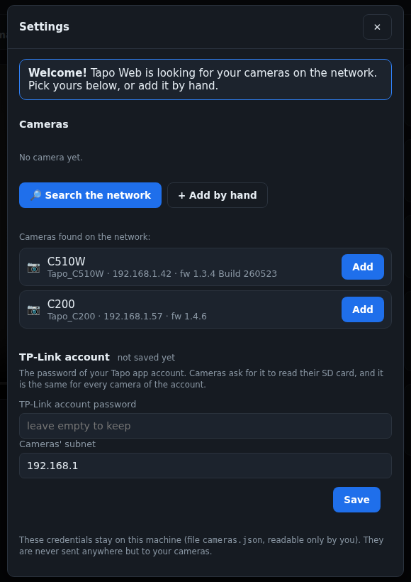
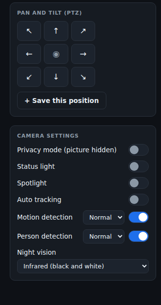

# tapo-web

[](https://github.com/freeKC/tapo-web/actions/workflows/tests.yml)
[](https://github.com/freeKC/tapo-web/releases)
[](LICENSE)


[Version française](README.fr.md)

**Your TP-Link Tapo cameras in a browser: live view, the videos on their SD card, and automatic
animal detection. Everything stays on your network. No cloud, no account, no subscription.**

It started because I wanted to know who empties the cat's bowl at 3 am.

It's a stone marten.


## What you get

- **Every camera live**, one at a time or all of them on one screen, in HD or SD, with snapshots,
  recording on demand and a continuous DVR.
- **The SD card as a video library.** A calendar of the days with recordings, a 24 h timeline,
  the camera's own thumbnail for each clip. A clip starts playing after two seconds and downloads
  at about 10x realtime, as a normal MP4 with the original H.264 (no re-encode).
- **Animal detection** on every clip, in the background, with [DeepFaune](https://www.deepfaune.cnrs.fr).
  Pick a species and get all its videos across all days, with a frame where the animal is boxed.
  Clips are kept on disk, so they are still there long after the card has looped over them.
- **Camera settings** without the Tapo app: privacy mode, status LED, spotlight, auto tracking,
  motion and person detection with their sensitivity, night vision mode, pan and tilt with
  saved positions. Each camera only shows what it has.
- **A setup that finds your cameras.** It scans the network, says which model and firmware it
  found, walks you through the two accounts the camera wants, and tests the connection.
- **Works with recent firmware** that answers `-40211` to pytapo, python-kasa and Home Assistant.
  This app speaks the newer login (V4, SPAKE2+) and the older one, and picks the right one by
  itself.
- Runs on **Linux, WSL, Windows or Docker**. The UI is in English, French, German, Spanish and
  Polish.

## Quick start

You need Python 3.12 and ffmpeg. Then pick one:

**Linux or WSL** (with [uv](https://github.com/astral-sh/uv), or plain pip)

```bash
git clone https://github.com/freeKC/tapo-web && cd tapo-web
uv venv .venv && uv pip install --python .venv/bin/python -r requirements.txt
./start.sh            # then open http://localhost:8088
```

**Windows**

```powershell
git clone https://github.com/freeKC/tapo-web; cd tapo-web
python -m venv .venv
.\.venv\Scripts\python.exe -m pip install -r requirements-windows.txt
.\start.bat           # starts the server and opens the browser
```

**Docker**

```bash
git clone https://github.com/freeKC/tapo-web && cd tapo-web
mkdir -p config data && docker compose up -d --build
```

Details, Docker Desktop included, in [docs/DOCKER.md](docs/DOCKER.md).

On the first start the settings open by themselves and look for cameras on the network. From the
Tapo app you need three things:

1. the **camera account**: in the Tapo app, the camera, then ⚙, Advanced settings, Camera
   account. It is used for the live view, recordings and pan and tilt;
2. your **TP-Link account password** (the one you log into the Tapo app with). The camera wants
   it for its SD card;
3. **Third-Party Compatibility** turned on: Me, Tapo Lab, Third-Party Compatibility. Without it
   recent firmware refuses local logins.

Everything is kept in `cameras.json` on your machine, readable by you only, and only ever sent to
your cameras. Settings can only be changed from the machine that runs the app (or the addresses
you list in `TAPO_ADMIN_HOSTS`).

<p align="center">
  
  
</p>

## The SD card

A calendar of the days that have recordings, a 24 h timeline and one row per clip with the
camera's own thumbnail. Filters by what the camera or the detection saw (animals, a species,
people, vehicles). Play starts while the rest of the clip is still coming in. Download gives you a
plain MP4.


The app never writes to or deletes anything on the card.

## Animal detection


It uses [DeepFaune](https://www.deepfaune.cnrs.fr) (CNRS), a model trained on European wildlife
camera traps: fox, marten and other mustelids, badger, hedgehog, cat, dog, roe deer, wild boar,
birds and so on. A YOLO detector finds the animal, a ViT classifier names it. It copes well with
infrared night footage, which is when all the interesting visitors come by.

A few things I had to add to make it usable on a garden camera:

* frames are sampled densely in the first seconds of a clip, because the animal that triggered
  the recording is often gone after three seconds
* anything that sits in exactly the same spot frame after frame gets dropped (a dark corner of
  my driveway was a "bird" every single night), unless the classifier is very sure, so a cat
  sitting still on the wall is still a cat
* species that make no sense here (the model once saw a cow on my terrace) fall back to a
  plain "animal" tag
* a wrong tag can be removed by hand, and that stays true after a new analysis

On an old GTX 1050 a one minute clip takes about 16 seconds, so a full day of recordings is done
in under 20 minutes. It also runs on CPU, just slower. Out of my first 697 clips, 418 were
nothing at all, 180 were our dog, and 5 were the marten. That is the point of the whole thing.

It is optional (about 8 GB with PyTorch and the model weights), and Linux only for now:

```bash
./ml/setup.sh
```

The model runs in its own process and virtualenv, and stops when there is nothing to do. Viewing
always has priority over background work. The whole chain and the numbers are in
[docs/DETECTION.md](docs/DETECTION.md).

## Which cameras?

Tested here with a **C510W** on firmware 1.3.4, where everything works. A contributor runs it on
a **C520WS** (firmware 1.3.5, older login), and the C200 login quirks are handled. Other
mains-powered Tapo cameras should work the same way: the live view and local recordings only need
RTSP, which they all have.

What is known so far is in [docs/CAMERAS.md](docs/CAMERAS.md). If you try it on another model,
please [tell me how it went](https://github.com/freeKC/tapo-web/issues/new?template=camera-report.yml),
good or bad: the settings have a "Copy the diagnostics" button that gives everything I need,
without any address or password.

## On a phone, a TV or a headset

My other app, **[Immuch360](https://github.com/freeKC/Immuch360)**, connects to Tapo cameras
too. It shows them live on Android, Android TV, the Meta Quest and Windows, and lists the
recordings of the SD card day by day on every platform. A clip plays like any other video and can
be sent to your Immich server. Same idea: it talks to the camera on your network only, never to
TP-Link's servers.

## When something goes wrong

* **"TP-Link account password refused"** in the connection test: check the password, and turn
  on Third-Party Compatibility in the Tapo app. Don't try several passwords in a row: after a few
  wrong ones the camera blocks logins for about 30 minutes.
* **The camera is not found**: check the subnet in the settings (the first three parts of your
  network addresses, for example 192.168.1), or type the camera's IP. Under WSL the app scans the
  real LAN, not WSL's own network, which is why the subnet matters.
* **"Camera busy"** when playing a clip: the camera serves one video session at a time, and the
  Tapo app was probably open on it. Close it and try again.
* **`-40211` with other tools**: that is the newer V4 login. How it works is written up in
  [tapo-v4-protocol](https://github.com/freeKC/tapo-v4-protocol), and pytapo supports it since
  3.4.20.

## Why this exists

After a firmware update my C510W stopped answering pytapo, python-kasa and the Home Assistant
integration: `error_code -40211` on every login. The camera had moved to a new local protocol
(SPAKE2+ handshake, then an AES-CCM channel) that nobody had documented. I worked it out and wrote
it all down in **[tapo-v4-protocol](https://github.com/freeKC/tapo-v4-protocol)**. This app is
built on top of that, and the findings went into pytapo, python-kasa and the Tapo Control
integration for Home Assistant.

Clips come off the SD card at about 10x realtime (a 66 s clip in 7 s on my Wi-Fi). Tools built on
the older `playback` request get the same clip at 1x, so one minute of video takes one minute.
The difference comes from the `download` request of the camera's media port.

## Contributing

Bug reports, camera reports, translations and code are all welcome. Start with
[CONTRIBUTING.md](CONTRIBUTING.md): how to run the tests (they need no camera), the rules for
testing against a real one, and how to add a language. Thanks to
[@uzior](https://github.com/uzior) for the Windows support, the older login and the Polish UI.

Useful settings in `.env` (see `.env.example`): `TAPO_DATA_DIR` to put the videos on another
drive, `TAPO_ANALYZE_KEEP` (`all`, `animals` or `none`), `TAPO_ANALYZE_AUTO=0` to analyse only on
demand.

## Notes

* Runs fine under WSL2. If WSL goes to sleep when you close the terminal, start the app from a
  Windows scheduled task instead.
* There is no login on the web UI: anyone who can reach the port can watch the cameras.
  `start.sh` and `start.bat` listen on 127.0.0.1 only for that reason.
* Not affiliated with TP-Link.

Keywords, for people searching: Tapo C510W, C500, C520WS, C200, C210, C220, C225, C100, C110,
C120, C310, C320WS, TP-Link Tapo local API, error -40211, "Invalid authentication data",
encrypt_type 4, SPAKE2+, download Tapo SD card recordings to PC, Tapo without cloud, several Tapo
cameras in a browser, Tapo Home Assistant, pytapo alternative, wildlife camera, trail camera
software, fouine, marten, fox, hedgehog, DeepFaune, MegaDetector, PyTorch GTX 1050, Docker.

MIT license. DeepFaune has its own license (CeCILL / CC BY-SA for the weights) and is downloaded
by the setup script, not included here.
